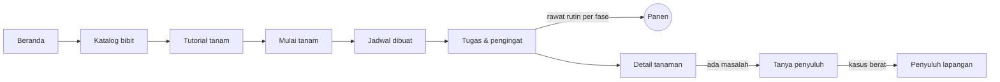

# PRD — TaniPintar

23 November 2026 · Sxored Dev 1

## Ringkasan

TaniPintar adalah pendamping tanam digital yang menuntun pengguna dari memilih bibit, menanam, merawat, sampai panen — dengan jadwal rawat otomatis, tutorial per tanaman, tanya penyuluh, serta panduan dan blog pertanian.

**Masalah.** Pekebun rumah dan petani pemula sering gagal bukan karena kurang niat, tetapi karena informasi yang terpencar: kapan siram (pagi atau sore), pupuk apa di fase mana, dan cara mengenali hama. Tutorial di internet jarang disesuaikan dengan fase tanaman, lokasi, dan cuaca setempat.

**Solusi.** Satu aplikasi web (responsif ke ponsel) yang: (1) memberi tutorial tanam langkah demi langkah per bibit, (2) membuat jadwal siram, pupuk, dan periksa sesuai fase dan cuaca, (3) menjawab pertanyaan sesuai konteks tanaman pengguna, dan (4) menyediakan panduan serta blog untuk memaksimalkan hasil.

**Desain acuan:** 9 halaman — Beranda, Detail tanaman, Jadwal rawat, Tanya penyuluh, Katalog bibit, Tutorial tanam, Panduan, Blog, Artikel (lihat folder `prototype/`).

## Tujuan & metrik

Tujuan rilis pertama: pengguna baru berhasil menanam satu bibit dan merawatnya rutin hingga panen.

**Tujuan**

- Pengguna baru memulai tanaman pertama dalam satu sesi (pilih bibit → tutorial → jadwal dibuat).
- Pengguna menyelesaikan tugas rawat harian secara konsisten.
- Pengguna mendapat jawaban perawatan yang sesuai fase tanamannya tanpa mencari di tempat lain.
- Blog dan panduan menjadi pintu masuk pengguna baru dan sumber belajar pengguna lama.

**Non-tujuan (rilis pertama)**

- Marketplace jual-beli bibit atau hasil panen.
- Integrasi sensor IoT (kelembapan tanah, pompa otomatis).
- Skala lahan pertanian komersial (hektare).

**Metrik keberhasilan** (target diisi tim produk)

| Metrik | Definisi | Target |
| --- | --- | --- |
| Aktivasi | % pendaftar yang membuat tanaman pertama dalam 24 jam | [TARGET] |
| Kepatuhan rawat | % tugas harian yang ditandai selesai per minggu | [TARGET] |
| Retensi | % pengguna aktif di minggu ke-4 | [TARGET] |
| Panen tercatat | % tanaman yang mencapai status panen | [TARGET] |
| Kepuasan jawaban | % jawaban penyuluh yang dinilai membantu | [TARGET] |
| Konten | Pembaca blog/panduan yang lanjut membuat tanaman | [TARGET] |

## Persona

| Persona | Konteks | Kebutuhan utama |
| --- | --- | --- |
| Pekebun rumah pemula | Pekarangan atau balkon, polibag, waktu terbatas pagi/sore | Tahu mau tanam apa, langkah jelas, pengingat siram |
| Hobiis berpengalaman | Beberapa jenis tanaman, ingin hasil lebih banyak | Pupuk per fase, kendali hama, tips hasil maksimal |
| Petani muda / kelompok tani | Bedengan, beberapa komoditas | Jadwal terencana, akses penyuluh, kabar musim |
| Penyuluh pertanian | Membina petani di wilayahnya | Menjawab pertanyaan yang diteruskan, menulis panduan/blog |

## Struktur halaman

Navigasi atas: Beranda · Katalog Bibit · Jadwal Rawat · Panduan · Blog · Tanya Penyuluh, plus tombol **Mulai tanam** dan akun. Beranda dibagi per section saat di-scroll agar tidak terlalu penuh.

| Halaman | File prototype | Isi utama | Dibuka dari |
| --- | --- | --- | --- |
| Beranda | `index.html` | Sapaan + cuaca + lokasi, tanaman yang sedang ditanam, ringkasan kebun, tugas rawat hari ini, tanya penyuluh singkat, tips hasil maksimal, tanaman aktif, cara kerja, panduan populer, blog, CTA penyuluh | Login, logo |
| Detail tanaman | `TanamanDetail.html` | Fase & perjalanan tanam, waktu siram pagi/sore/siang, kebutuhan (cahaya, media, air, pH), pupuk per fase, hama & penyakit, tips, riwayat, foto perkembangan | Kartu tanaman aktif |
| Jadwal rawat | `JadwalRawat.html` | Pilih hari, filter Siram/Pupuk/Periksa, centang tugas, catatan cuaca, ringkasan minggu, pengingat | "Lihat jadwal minggu ini" |
| Tanya penyuluh | `TanyaPenyuluh.html` | Riwayat percakapan, chat dengan konteks tanaman, kirim foto/suara, pertanyaan cepat, eskalasi ke penyuluh lapangan | Kartu penyuluh, chip, CTA |
| Katalog bibit | `KatalogBibit.html` | Cari, filter kategori & pemula, info lahan, kartu bibit | "Mulai tanam", "Tambah bibit" |
| Tutorial tanam | `BibitDetail.html` | Ringkasan bibit, form mulai tanam, tutorial 6 langkah, jadwal yang akan dibuat, panduan terkait | Kartu bibit |
| Panduan | `PanduanDetail.html` | Artikel panduan dengan daftar isi, ringkasan visual, tabel per jenis, kesalahan umum | Panduan populer |
| Blog | `Blog.html` | Artikel pilihan, filter kategori, daftar artikel, langganan email | Section blog di Beranda |
| Artikel blog | `BlogDetail.html` | Isi artikel, penulis/peninjau, tips penyuluh, tag, artikel terkait | Kartu artikel |

## Kebutuhan fungsional

Prioritas: P0 = wajib di MVP, P1 = rilis berikutnya, P2 = nanti.

| ID | Fitur | Kebutuhan | Prioritas |
| --- | --- | --- | --- |
| F1 | Akun & lokasi | Daftar/masuk (email, nomor HP), set lokasi kebun (kab/kota) untuk cuaca, profil lahan (pekarangan/balkon/bedengan, jam cahaya) | P0 |
| F2 | Katalog bibit | Daftar bibit dengan kategori, lama panen, tingkat kesulitan, media, cahaya; cari & filter; label "Cocok" berdasarkan profil lahan | P0 |
| F3 | Tutorial tanam | Langkah bertahap per bibit (persiapan, semai, pindah tanam, perawatan, panen) dengan checklist, gambar, tips; navigasi sebelumnya/berikutnya | P0 |
| F4 | Mulai tanam | Form tanggal semai, jumlah polibag/bedeng, lokasi → membuat tanaman aktif dan jadwal rawat otomatis | P0 |
| F5 | Jadwal rawat | Tugas siram/pupuk/periksa per hari dari template fase; tampilan hari ini & mingguan; centang selesai; filter jenis | P0 |
| F6 | Penyesuaian cuaca | Ambil prakiraan harian; lewati siram sore saat peluang hujan tinggi; tampilkan alasan | P1 |
| F7 | Pengingat | Notifikasi aplikasi 15 menit sebelum tugas; opsi WhatsApp; atur jam siram | P0 (aplikasi), P1 (WhatsApp) |
| F8 | Detail tanaman | Fase & timeline, waktu siram terbaik, kebutuhan, pupuk per fase, hama & penyakit, tips, riwayat, foto mingguan | P0 |
| F9 | Tanya penyuluh | Chat dengan konteks tanaman (jenis + fase); pertanyaan cepat; lampiran foto; jawaban otomatis dengan tautan panduan; eskalasi ke penyuluh manusia | P0 (teks), P1 (foto, suara, eskalasi) |
| F10 | Tips hasil maksimal | Kartu tips kontekstual per fase di Beranda & detail tanaman | P0 |
| F11 | Panduan | Artikel panduan terstruktur, simpan/bookmark | P0 |
| F12 | Blog pertanian | Daftar artikel, kategori, artikel pilihan, detail artikel, artikel terkait, bagikan | P0 |
| F13 | Langganan email | Ringkasan mingguan artikel & tips musim | P2 |
| F14 | CMS konten | Admin/penyuluh membuat & meninjau bibit, tutorial, panduan, blog; status draf/terbit | P0 |
| F15 | Ringkasan kebun | Jumlah tanaman aktif, perkiraan air hari ini, tugas tersisa | P0 |

## Alur pengguna utama

Pengguna memilih bibit, mengikuti tutorial, lalu sistem membuat jadwal; tugas harian dirawat hingga panen, dan masalah dibawa ke Tanya penyuluh (diteruskan ke penyuluh lapangan bila berat). Blog dan panduan di Beranda menjadi jalur masuk kedua ke katalog dan tutorial.

## Model data & integrasi

| Entitas | Atribut utama |
| --- | --- |
| Pengguna | id, nama, kontak, lokasi (kab/kota, koordinat), profil lahan, preferensi pengingat |
| Bibit | id, nama, kategori, lama panen (hari), tingkat, media, kebutuhan cahaya, pH, daftar fase (nama, hari mulai–akhir) |
| Langkah tutorial | bibit_id, urutan, judul, waktu, isi, checklist, tips, gambar |
| Template rawat | bibit_id, fase, jenis (siram/pupuk/periksa), jam, takaran, frekuensi, catatan |
| Tanaman aktif | id, pengguna_id, bibit_id, tanggal semai, jumlah wadah, lokasi, fase saat ini (dihitung) |
| Tugas | tanaman_id, tanggal, jam, jenis, catatan, status (terjadwal/selesai/dilewati), alasan lewati |
| Catatan & foto | tanaman_id, tanggal, jenis, teks, foto |
| Percakapan & pesan | pengguna_id, tanaman_id (konteks), pesan, lampiran, status eskalasi |
| Konten | jenis (panduan/blog), judul, kategori, isi, penulis, peninjau, tanggal terbit, waktu baca |

**Integrasi**

- Prakiraan cuaca per lokasi (mis. API BMKG atau penyedia cuaca lain) — dipanggil harian.
- Layanan notifikasi push; WhatsApp Business API untuk P1.
- Model bahasa untuk jawaban otomatis Tanya penyuluh, dibatasi pada basis pengetahuan TaniPintar dan konteks tanaman.
- Penyimpanan objek untuk foto.

## Non-fungsional & desain visual

**Non-fungsional**

- Responsif: desktop 1280–1440 px dan ponsel 360 px; navigasi membungkus di layar kecil.
- Ringan untuk koneksi lambat: Beranda dimuat cepat di jaringan 3G/4G; gambar dikompres.
- Aksesibilitas: kontras teks ≥ 4,5:1, target sentuh ≥ 44 px, tombol dan label form nyata.
- Bahasa Indonesia sebagai default; satuan metrik; format tanggal "23 November 2026", jam "06.30".
- Keamanan data pengguna: lokasi dan foto hanya terlihat oleh pemilik.
- Konten perawatan ditinjau penyuluh sebelum terbit; jawaban otomatis mencantumkan bahwa kasus berat diteruskan ke penyuluh.

**Desain visual**

| Token | Nilai | Dipakai untuk |
| --- | --- | --- |
| Primary (Forest Green, Deep Pine, Mint Mist) | #2E7D32 / #1B5E20 / #E8F5E9 | Hero, tombol utama, progres |
| Secondary (Vibrant Leaf) | #66BB6A | Progress bar sekunder |
| Latar & permukaan | #F4F7F5 / #FFFFFF / border #DCE5DE / hover #EDF3EF | Latar halaman, kartu |
| Accent (Harvest Amber) | #FFA000 / hover #F57C00 / #FFF8E1 | CTA, tips |
| Teks | #132A17 / #3E5643 / #6E8573 | Judul, paragraf, caption |
| Air / kelembapan | #0284C7 / #E0F2FE (teks #0369A1) | Hanya ikon air, tugas siram, status hujan |
| Pupuk / peringatan | #D97706 / #FEF3C7 (teks #92400E) | Tugas pupuk |
| Kritis / bahaya | #DC2626 / #FEE2E2 (teks #B91C1C) | Hama, peringatan, sayur buah |
| Tipografi | Poppins (judul), Inter (teks) | Hierarki judul vs isi |

Warna dipakai sebagai makna (siram = biru, pupuk = amber, periksa = hijau), bukan dekorasi. Biru muda khusus untuk air/hujan.

## Rilis, risiko & pertanyaan terbuka

**Rilis bertahap**

1. **MVP** — akun & lokasi, katalog (10–15 bibit sayur umum), tutorial tanam, mulai tanam, jadwal rawat + notifikasi aplikasi, detail tanaman, tanya penyuluh (teks), panduan, blog, CMS.
2. **Rilis 2** — penyesuaian cuaca, foto di tanya penyuluh, eskalasi ke penyuluh manusia, pengingat WhatsApp, foto perkembangan.
3. **Rilis 3** — langganan email, rekomendasi bibit dari profil lahan, komunitas/cerita pengguna, mode luring.

**Risiko**

| Risiko | Dampak | Mitigasi |
| --- | --- | --- |
| Jawaban otomatis keliru (dosis pupuk, pestisida) | Tanaman rusak, kepercayaan turun | Basis pengetahuan ditinjau penyuluh, dosis selalu merujuk label, tombol "laporkan jawaban" |
| Jadwal tidak cocok dengan kondisi nyata | Pengguna mengabaikan pengingat | Tugas bisa digeser/dilewati, belajar dari catatan pengguna, penyesuaian cuaca |
| Konten tutorial terlalu umum antar daerah | Hasil kurang optimal | Variasi per dataran rendah/tinggi dan musim |
| Notifikasi terlalu sering | Pengguna mematikan notifikasi | Gabungkan tugas dalam satu pengingat pagi/sore |

**Pertanyaan terbuka**

- [ ] Sumber data cuaca mana yang dipakai dan berapa biayanya?
- [ ] Penyuluh manusia: mitra dinas pertanian, relawan, atau tim internal?
- [ ] Daftar bibit untuk MVP dan siapa yang menulis tutorialnya?
- [ ] Model bisnis: gratis + premium, kemitraan toko tani, atau sponsor konten?
- [ ] Aplikasi ponsel native diperlukan di MVP atau cukup web responsif/PWA?
